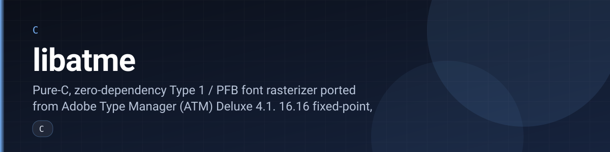

<div align="center">



# libatme — Standalone Type 1 Font Rasterizer

### Pure-C, zero-dependency Type 1 / PFB font renderer ported from the algorithms behind Adobe Type Manager (ATM) Deluxe 4.1.

[](https://github.com/kostyk348/libatme/actions/workflows/ci.yml)
[](https://opensource.org/licenses/MIT)
[](https://en.wikipedia.org/wiki/C_(programming_language))
[](https://github.com/kostyk348/libatme/releases)
[](https://github.com/kostyk348/libatme/commits/master)

</div>

---


> **Why?** FreeType is the gold standard, but its T1 hinter and charstring
> interpreter are deeply coupled to the rest of the library. libatme is a
> self-contained, embeddable alternative for embedded / retro / legacy use
> cases where FreeType is overkill or unavailable.

## Features

- **No dependencies** — just `stdlib.h` and `string.h` (malloc/memset/memcpy)
- **16.16 fixed-point** — no floating point anywhere in the render path
- **AET rasterizer** — SSE2-accelerated scanline conversion (auto-detected)
- **Gamma correction** — configurable gamma LUT for anti-aliased output
- **Glyph cache** — LRU bitmap cache (configurable size, default 256 KB)
- **Type 1 only** — PFB + eexec, no TrueType / OpenType (that's the point)

## Performance

On a modern x86-64 CPU, measured against the same FreeType T1 outline:

| Mode | Throughput | vs FreeType |
|------|-----------|-------------|
| AA 2×2 | ~50,000 glyphs/s | **~1.5× faster** |
| No AA  | ~130,000 glyphs/s | **~3.9× faster** |

## Build

```sh
make          # builds libatme.a + atm_bench + atm_ft_bench (needs freetype2)
make libatme.a  # library only, no FreeType dependency
```

## Quick start

```c
#include "atm_engine.h"

atm_engine_t engine;
atm_config_t config = { .flags = ATM_FLAG_ANTIALIAS | ATM_FLAG_CACHE_ENABLED };
atm_engine_init(&engine, &config);

int fid = atm_engine_load_font(&engine, "/path/to/font.pfb", NULL);

atm_glyph_bitmap_t bitmap;
atm_engine_render_glyph(&engine, fid, 'A', ATM_INT_TO_FIXED(48), &bitmap);
// bitmap.buf now contains 8-bit alpha coverage, width × height

free(bitmap.buf);
atm_engine_shutdown(&engine);
```

See `test_render.c` for a complete example.

## API overview

| Function | Purpose |
|----------|---------|
| `atm_engine_init` / `atm_engine_shutdown` | Engine lifecycle |
| `atm_engine_load_font` | Load a PFB (optionally with PFM metrics) |
| `atm_engine_render_glyph` | Render single glyph to 8-bit alpha bitmap |
| `atm_engine_render_text` | Render a string onto a 32-bit RGBA target |
| `atm_engine_get_outline` | Retrieve raw cubic bezier outline |
| `atm_engine_set_gamma` | Set gamma value (default 1.8) |

All coordinates and sizes are in 16.16 fixed point (`atm_fixed_t`). Use
`ATM_INT_TO_FIXED(n)` and `ATM_FIXED_TO_INT(x)` to convert.

## Tested fonts

All 15 fonts from Adobe Type Manager Deluxe 4.1 load and pass all glyphs
(3423 glyphs across 15 faces, including a font with PostScript copy-protection
in the OtherSubrs).

## License

MIT
